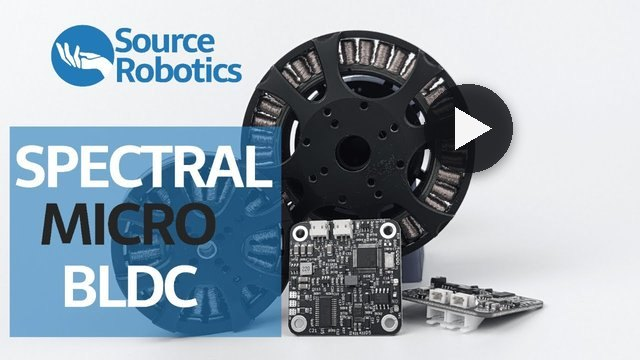

  

<h1 align="center">Spectral Micro</h1>

  <b>Compact FOC controller for brushless (BLDC) motors, with CAN, UART and open-source firmware.</b> 
  It mounts behind the motor, measures the motor in one calibration run, and controls its position, speed, torque or impedance.

  <a href="https://source-robotics.com/products/spectral-micro-bldc-controller"><b>Buy</b></a>&nbsp;&nbsp;·&nbsp;&nbsp;
  <a href="https://docs.source-robotics.com/Spectral-BLDC-docs/"><b>Documentation</b></a>&nbsp;&nbsp;·&nbsp;&nbsp;
  <a href="https://docs.source-robotics.com/Spectral-BLDC-docs/latest/quick-start/"><b>Quick start</b></a>&nbsp;&nbsp;·&nbsp;&nbsp;
  <a href="https://github.com/Source-Robotics/Spectral-Micro-BLDC-controller/releases/latest"><b>Download</b></a>&nbsp;&nbsp;·&nbsp;&nbsp;
  <a href="https://discord.com/invite/prjUvjmGpZ"><b>Discord</b></a>

  
  
  
  

| **12 to 29 V** | **1.5 A** | **14-bit** | **5 kHz** | **39 × 39 mm** |
|:-:|:-:|:-:|:-:|:-:|
| supply, 24 V typical | motor current, 2.8 A max | encoder | control loop | NEMA 17 size, 8 g |

## Project overview

<table>
  <tr>
    <td width="55%" valign="middle">
      Spectral Micro is a brushless motor controller designed to offer affordable and capable hardware, complemented
      by open-source software. It supports multiple firmware options, integrates a 14-bit magnetic encoder, inline
      current sensing and a CAN and UART data interface, and provides position, velocity, torque and impedance
      control. Everything you need for developing high-performance robotic solutions is included. It is ideal for
      gimbal motors, quadrupeds, robotic arms and grippers: see the
      <a href="https://docs.source-robotics.com/Spectral-BLDC-docs/latest/03-technical-data/tested-motors/">tested motors</a>.
        
      <a href="https://youtu.be/FRhTW86H9zU"><b>&#9654;&#xFE0E;&nbsp; Watch the Spectral Micro introduction</b></a>
    </td>
    <td width="45%" valign="middle">
      
    </td>
  </tr>
</table>

## Start here

| I want to | Go to |
|---|---|
| **Buy a driver or a starter kit** | [source-robotics.com](https://source-robotics.com/products/spectral-micro-bldc-controller) · [starter kit](https://source-robotics.com/products/spectral-micro-bldc-starter-kit) |
| **Choose a motor, mount and wire it** | [tested motors](https://docs.source-robotics.com/Spectral-BLDC-docs/latest/03-technical-data/tested-motors/) · [what you need](https://docs.source-robotics.com/Spectral-BLDC-docs/latest/01-overview/what-you-need/) · [mounting and wiring](https://docs.source-robotics.com/Spectral-BLDC-docs/latest/04-mounting/) · [STEP files](STEP%20files/) |
| **Set it up and make it move** | [Quick start](https://docs.source-robotics.com/Spectral-BLDC-docs/latest/quick-start/) · [Motor GUI](https://motorgui.com/) in the browser ([guide](https://docs.source-robotics.com/Spectral-BLDC-docs/latest/05-setup/motor-gui/)) · [calibration](https://docs.source-robotics.com/Spectral-BLDC-docs/latest/05-setup/calibration/) |
| **Control it** | [over CAN](https://docs.source-robotics.com/Spectral-BLDC-docs/latest/06-operation/can/) · [over UART](https://docs.source-robotics.com/Spectral-BLDC-docs/latest/06-operation/uart/) · [Python library](https://github.com/Source-Robotics/Spectral-BLDC-Python) and [Source Robotics toolbox](https://github.com/Source-Robotics/Source-Robotics-Toolbox) · [Arduino](https://github.com/Source-Robotics/SpectralMicroArduino) (early stage) · [ROS&nbsp;2](https://github.com/PCrnjak/SpectralMicroROS2) (early stage) · [API reference](https://docs.source-robotics.com/Spectral-BLDC-docs/latest/reference/) |
| **Run SimpleFOC on it** | [SimpleFOC port and examples](https://github.com/Source-Robotics/Spectral-Micro-Simple-FOC) · [SimpleFOC guide](https://docs.source-robotics.com/Spectral-BLDC-docs/latest/guides/simplefoc/) |
| **Update the firmware** | [latest release](https://github.com/Source-Robotics/Spectral-Micro-BLDC-controller/releases/latest) · [updating through the bootloader](https://docs.source-robotics.com/Spectral-BLDC-docs/latest/07-firmware/update/) · [a board without the bootloader](https://docs.source-robotics.com/Spectral-BLDC-docs/latest/07-firmware/bootloader/) |
| **Use it in a gripper or a robot** | [SSG-48 gripper](https://github.com/Source-Robotics/SSG-48-adaptive-electric-gripper) · [gripper mode](https://docs.source-robotics.com/Spectral-BLDC-docs/latest/06-operation/gripper-mode/) · [guides](https://docs.source-robotics.com/Spectral-BLDC-docs/latest/guides/): mobile robot, quadruped leg, gravity compensation, teleoperation |

<b>What is in this repository</b>

| Folder | What is in it |
|---|---|
| [`Spectral BLDC Firmware`](Spectral%20BLDC%20Firmware/) | the firmware (PlatformIO, STM32F103CB): on `main` the one for boards without the bootloader (release 101 and earlier, no longer updated); releases from 104 on are built from the [`Bootloader_main`](https://github.com/Source-Robotics/Spectral-Micro-BLDC-controller/tree/Bootloader_main) branch |
| [`Binaries`](Binaries/) | `firmware.bin`, the build of this branch, for a board without the bootloader |
| [`STEP files`](STEP%20files/) | the board and an example mounting bracket |
| [`Test scripts`](Test%20scripts/) | `PI_current_loop_calib.py`, the current loop's PI gains from a motor's resistance and inductance |
| [`Photos`](Photos/) | product photos |

The [latest release](https://github.com/Source-Robotics/Spectral-Micro-BLDC-controller/releases/latest) has the
firmware image (`spectral-bldc-firmware-V<number>.bin`) and its manifest (`firmware.json`);
[Motor GUI](https://motorgui.com/) flashes it from there. [`en.stsw-link009.zip`](en.stsw-link009.zip) is the ST-LINK USB
driver (STSW-LINK009), for the programming adapter on Windows.

## Community

Ask in [Discussions](https://github.com/orgs/Source-Robotics/discussions), chat on
[Discord](https://discord.com/invite/prjUvjmGpZ), report a bug in
[Issues](https://github.com/Source-Robotics/Spectral-Micro-BLDC-controller/issues), and follow Source Robotics:

## Safety, liability and disclaimer

1. The software and hardware are still in development and may contain bugs, errors, or incomplete features.
2. Users are encouraged to use this software and hardware responsibly and at their own risk.

Read the manual's [safety chapter](https://docs.source-robotics.com/Spectral-BLDC-docs/latest/02-safety/) before you wire and power the driver.

## Licensing

Spectral firmware is under GPLv3 Licence

## Versions

Which firmware release your driver runs, and what works with it: [VERSIONS.md](VERSIONS.md).
